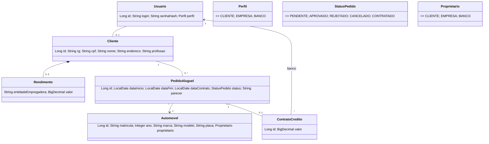
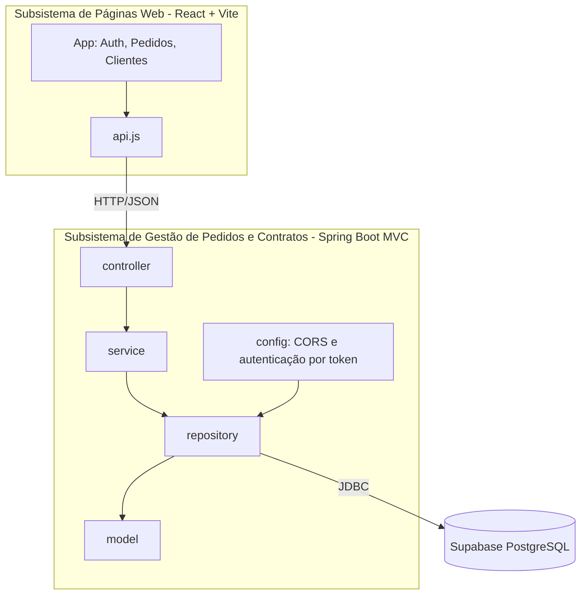

# Modelagem (UML) — Sistema de Aluguel de Carros

> Diagramas em Mermaid (renderizam no GitHub). O diagrama de casos de uso em UML está em [`casos-de-uso.puml`](casos-de-uso.puml) (PlantUML). Atualize conforme o feedback em aula e versione cada revisão.

## Histórias do Usuário
- **US01** Como visitante, quero me cadastrar e fazer login (usuário e senha) para usar o sistema.
- **US02** Como cliente, quero criar um pedido de aluguel informando o automóvel, o proprietário e o período.
- **US03** Como cliente, quero consultar o status dos meus pedidos.
- **US04** Como cliente, quero modificar ou cancelar um pedido ainda pendente.
- **US05** Como cliente, quero manter meus dados (RG, CPF, nome, endereço, profissão e até 3 rendimentos).
- **US06** Como agente (empresa/banco), quero cadastrar e manter clientes.
- **US07** Como agente, quero modificar e avaliar financeiramente os pedidos (parecer positivo ou negativo).
- **US08** Como agente, quero executar o contrato de um pedido aprovado.
- **US09** Como banco, quero associar um contrato de crédito ao aluguel.

## Casos de Uso
Ver `docs/casos-de-uso.puml` (UML). Resumo: Cliente (US01–US05), Agente-Empresa (US01, US06–US08), Agente-Banco herda do agente e ainda concede crédito (US09, *extend* de "Executar contrato").

## Diagrama de Classes

## Diagrama de Pacotes (Visão Lógica)
O sistema é dividido em dois subsistemas: **gestão de pedidos e contratos** (back-end) e **construção dinâmica das páginas web** (front-end).

## Fluxo do pedido
`PENDENTE` → (agente avalia) `APROVADO` ou `REJEITADO` → (agente executa contrato) `CONTRATADO`. O cliente pode `CANCELAR` enquanto estiver `PENDENTE`.
